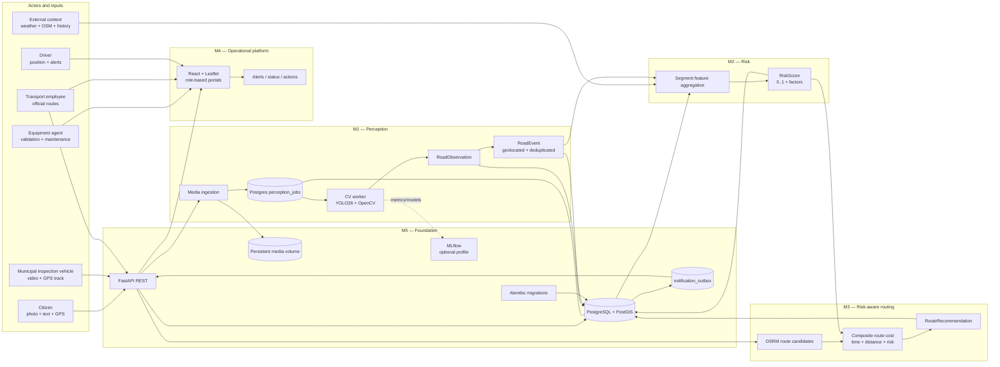
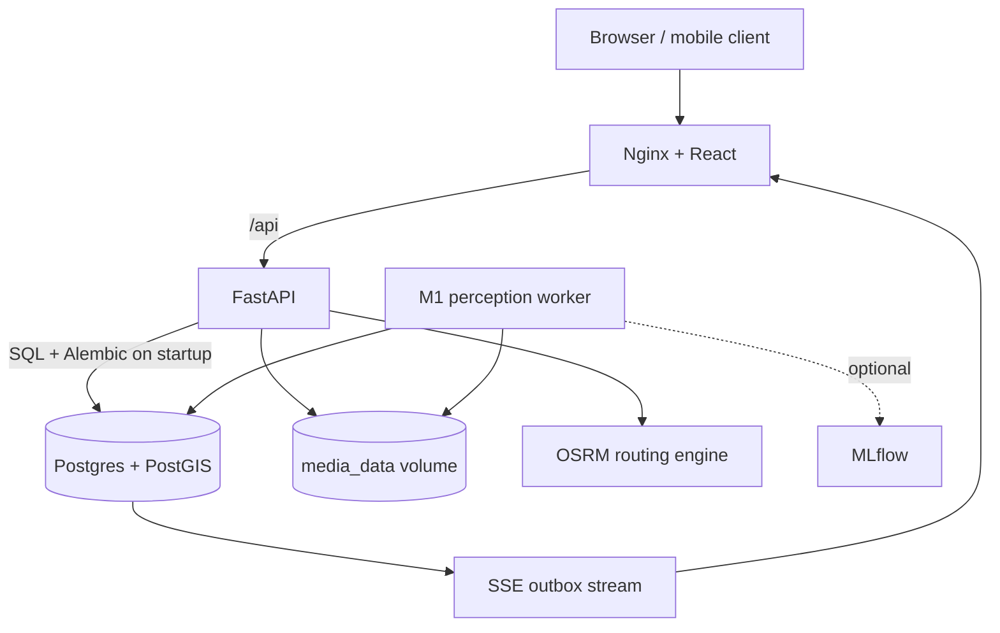

# THNIYETNA v2 — target architecture

This version keeps the five work packages and five actors, but removes the old
object-storage dependency and makes Postgres/PostGIS the durable coordination
backbone. Media is stored on a persistent local volume; database rows store only
relative media references and metadata.

## 1. Global architecture

## 2. Actor-to-work-package ownership

| Actor | Main interaction | WP path |
|---|---|---|
| Citizen | Submit road photo + GPS, follow status | M4 → M5 API → M1 → M2 → M4 |
| Inspection vehicle | Upload video and timestamped GPS samples | M4/device client → M5 → M1 |
| Equipment agent | Validate events, prioritize maintenance, update status | M4 → M2/M1 data via M5 |
| Transport employee | Manage official routes and see affected routes | M4 → M3 via M5 |
| Driver | Receive risk alert and safer alternative | M4 ← M3 ← M2 |

M5 is not a sixth business module. It is the shared contract and persistence
layer that allows M1–M4 to evolve independently.

## 3. M1 production flow

```mermaid
flowchart LR
  I1[Citizen image] --> STORE[Local persistent media]
  I2[Vehicle video] --> STORE
  GPS[Timestamped GPS samples] --> P[(inspection_positions)]
  STORE --> JOB[(perception_jobs)]
  JOB --> CLAIM[Worker claims job\nFOR UPDATE SKIP LOCKED]
  CLAIM --> DECODE[OpenCV decode]
  DECODE --> SAMPLE[Time-based frame sampling\n5 FPS default]
  SAMPLE --> BATCH[Batch inference]
  BATCH --> YOLO[Fine-tuned YOLO26n/s]
  YOLO --> DET[Class + confidence + box]
  DET --> SEV[Visual severity proxy]
  P --> GEO[GPS interpolation]
  DET --> GEO
  GEO --> OBS[(RoadObservation)]
  OBS --> SNAP[Nearest road segment]
  SNAP --> DEDUP[Spatial-temporal dedup]
  DEDUP --> EVENT[(RoadEvent)]
  EVENT --> OUT[(notification_outbox)]
```

### Why two entities: Observation vs Event

A video can see the same pothole in several consecutive frames. Each model
output is an **observation**. Several observations can be linked to one physical
**RoadEvent** using defect class, time and geospatial proximity. This avoids
inflating risk merely because a defect remained visible for multiple frames.

## 4. Data and migration rules

- Alembic is the only schema migration mechanism.
- `alembic upgrade head` runs in the API entrypoint before Uvicorn starts.
- No demo seed runs at startup. Alembic owns schema evolution; citizens register normally and operational identities are bootstrapped by migration.
- PostGIS stores geometry and spatial indexes.
- Media files live in the `media_data` Docker volume and are served through the API.
- `notification_outbox` remains the durable realtime source for SSE.

## 5. Deployment topology

The M1 worker is isolated from FastAPI because PyTorch/OpenCV are heavy and
should not increase API startup time or memory. The worker and API coordinate
through PostgreSQL plus the shared media volume.
